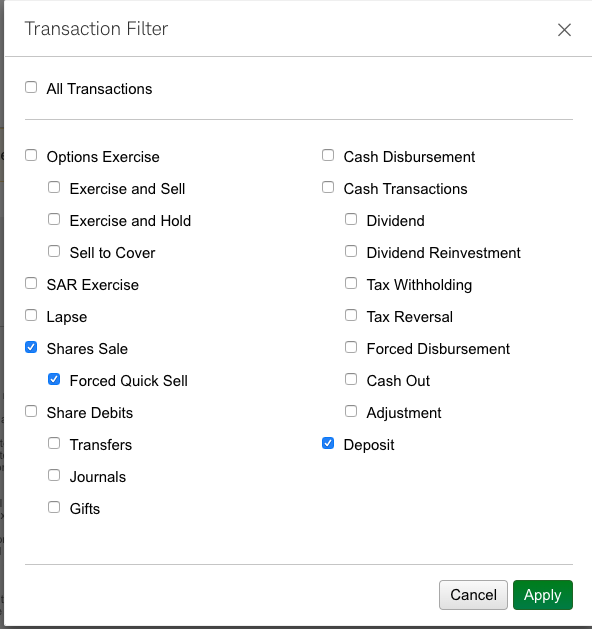

# UK Capital Gains Tax Calculator

**THIS IS NOT FINANCIAL ADVISE.**

Get the [eurofxref-hist.zip](https://www.ecb.europa.eu/stats/eurofxref/eurofxref-hist.zip) for the ECB and extract to get euroxref-hist.zip. Pass this with the `--fx` option.

Go to [Schwab's transaction history](https://client.schwab.com/Apps/accounts/transactionhistory/#/).

## Schwab EAC

Select filters



Export with legit JS

```
$(".sch-caret-up").click()


var data='"Txn Date","Action","Symbol","Description","Quantity","Grant Date","Grant","Date","Price"\n';
var i = 0;
var first = true;
$(".data-row").each(function() {
  $(this).find("td").each(function(j) {
      if (this.innerText !== "") {
        if (!first) {
          data += ',';
        }
        first = false;
        data +=  '"' + this.innerText + '"';
      }
  })
  if (i % 2 == 1) {
    data += "\n";
    first = true;
  }
  i++;
})
```
